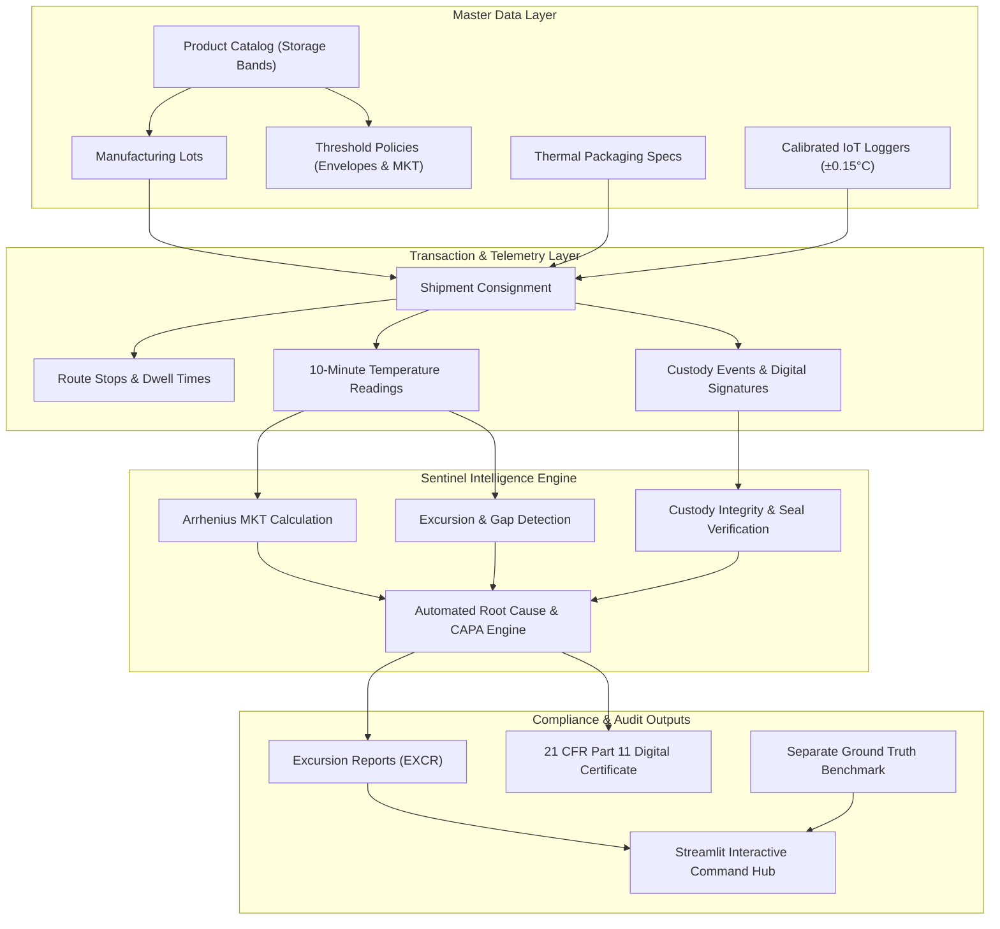

# ❄️ ColdChain Sentinel — End-to-End Pharma Cold Chain Compliance & Deviation Management

> **Hackathon Solution**  
> **Problem Statement:** Prove that temperature-sensitive shipments remained within product and route requirements, and manage deviations.  
> **Standards Alignment:** **FDA 21 CFR Part 11**, **USP <1079> Good Storage and Shipping Practices**, **EU GDP (Good Distribution Practice)**.

---

## 🌟 Executive Pitch & Key Highlights

In the biopharmaceutical supply chain, temperature breaches during transit degrade life-saving mRNA vaccines, cell therapies, and monoclonal antibodies, costing the industry over \$35 billion annually. 

**ColdChain Sentinel** provides an end-to-end auditability and compliance engine that:
1. **Tracks and Validates Thermal Integrity:** Evaluates continuous 10-minute sensor telemetry against product-specific tolerance envelopes.
2. **Calculates Physics-Based Arrhenius MKT (Mean Kinetic Temperature):** Implements the official USP <1079> non-linear kinetic temperature degradation formula.
3. **Enforces End-to-End Chain of Custody:** Tracks handovers, airport tarmac dwell durations, and tamper-evident digital signatures.
4. **Governs Automated CAPA Workflows:** Automatically diagnoses root causes, generates regulatory Corrective and Preventive Actions (CAPA), and recommends quality dispositions (Release, Quarantine, Reject).
5. **Cryptographic Proof of Compliance:** Produces a tamper-evident SHA-256 digital fingerprint across readings and custody milestones for instant auditability.
6. **100% Deterministic & Reproducible:** Fixed seed `20261022` with bit-for-bit reproducibility verified across runs.

---

## 📐 System Architecture & Workflow



---

## 🧪 Scientific Foundation: Arrhenius Mean Kinetic Temperature (MKT)

The **Mean Kinetic Temperature (MKT)** is a single calculated temperature that represents the cumulative thermal stress on a pharmaceutical product, giving greater weight to higher temperature spikes because biological degradation accelerates exponentially:

$$\Delta H / R = \frac{83.144 \text{ kJ/mol}}{8.314472 \times 10^{-3} \text{ kJ/(mol}\cdot\text{K)}} = 10,000 \text{ K}$$

$$T_{\text{MKT}} = \frac{10000}{-\ln\left(\frac{1}{n} \sum_{i=1}^{n} e^{-\frac{10000}{T_i + 273.15}}\right)} - 273.15$$

Where:
- $T_i$ = Reading temperature in Celsius at interval $i$
- $n$ = Total number of sensor readings
- $\Delta H$ = Standard activation energy for pharmaceutical stability ($83.144 \text{ kJ/mol}$)
- $R$ = Universal gas constant

---

## 🗂️ 10 Core Entities & Nomenclature Conventions

| Entity | Primary Key Format | Cardinality | Key Attributes & Foreign Keys |
| :--- | :--- | :--- | :--- |
| **Product** | `PRD-001` | Master (1:N with Lot/Policy) | Storage band (`ULTRA_COLD`, `REFRIGERATED`), critical freeze limit, shelf life |
| **Lot** | `LOT-2026-000001` | Child of Product (1:N with Shipment) | Batch number, manufacture date, expiration date, supplier ID |
| **Packaging** | `PKG-001` | Master (1:N with Shipment) | Insulation type (VIP), refrigerant (PCM, Dry Ice), rated protection hours |
| **Logger** | `LOG-000001` | Master / Assigned (1:1 with Shipment) | Calibration date, NIST uncertainty ($\pm 0.15^\circ\text{C}$), sampling rate (10 min) |
| **Shipment** | `SHP-2026-000001` | Core Transit Consignment | Origin, destination, planned/actual timestamps, declared value |
| **ShipmentLot** | `SHPLOT-2026-000001` | Bridge (Shipment $\leftrightarrow$ Lot) | Allocated vial quantity per manufacturing lot |
| **RouteStop** | `STOP-SHP-2026-000001-01`| Child of Shipment (1:N) | Sequence number, facility code, dwell minutes, exterior ambient temp |
| **CustodyEvent** | `CUST-SHP-2026-000001-01`| Child of Shipment (1:N) | Milestone event, actor name & role, SHA-256 digital signature, seal integrity |
| **TemperatureReading**| `TEMP-LOG-...-YYYYMMDDHHMM`| Child of Logger/Shipment (1:N) | Sensed temp, raw ADC temp, calibration offset, battery voltage, anomaly flag |
| **ThresholdPolicy** | `POL-001` | Child of Product (1:N) | Safe temperature band, max cumulative breach, max single spike, MKT ceiling |
| **ExcursionReport** | `EXCR-2026-000001` | 1:1 with Shipment | Severity, cumulative duration, peak/lowest temp, calculated MKT, CAPA plan, SHA-256 hash |
| **GroundTruth** | `ANOM-2026-000001` | Separate Benchmark Table | Injected anomaly category, injection details, expected severity & disposition |

---

## ⚡ Injected Negative Edge Cases (Ground Truth)

The generator injects controlled edge cases and isolates them in `ground_truth.csv`/`json`:
1. **`LOGGER_NOT_ASSIGNED`**: Consignment dispatched without active calibrated logger pairing. Engine flags `SENSOR_UNASSIGNED` and holds lot in quarantine.
2. **`THRESHOLD_MISMATCH`**: Product master assigned to incorrect thermal policy (e.g. evaluating -80°C mRNA vaccine under 2-8°C policy). Flagged as `PLANNING_ERROR_POLICY_MISMATCH`.
3. **`MISSING_DATA_GAP`**: Logger transmission blackout exceeding allowed threshold (>30 min) during tarmac transfer. Engine identifies gap and issues conditional quarantine.
4. **`CUSTODY_GAP`**: Unsigned transfer or broken tamper-evident security seal. Engine triggers `CUSTODY_INTEGRITY_BREACH` deviation.
5. **`CROSS_SHIPMENT_CONTAMINATION`**: Foreign logger or foreign shipment readings leaked into consignment trace. Flagged as `IOT_CROSS_SHIPMENT_LEAKAGE`.

---

## 🚀 Quickstart & Usage

### 1. Run Unit Tests (Pytest)
```bash
python -m pytest -v
```

### 2. Generate Dataset (Starter or Full 5,000 Shipments)
```bash
# Starter scale (50 shipments, instant, ~2s)
python cli.py generate --seed 20261022 --scale starter --export csv,json,sql

# Full scale (5,000 shipments, 1,000 loggers, 10-minute telemetry)
python cli.py generate --seed 20261022 --scale full --export csv,json,sql
```

### 3. Run Automated Validation Battery
```bash
python cli.py validate
```
Verifies:
- 100% Primary Key uniqueness
- 100% Foreign Key referential integrity
- Allowed enum validation
- Chronological date causality ($T_{\text{mfg}} < T_{\text{dep}} < T_{\text{arr}} < T_{\text{exp}}$)
- Arithmetic reconciliation (Peak, Low, Cumulative duration, MKT formula)
- Lifecycle consistency
- Zero duplicates

### 4. Verify Reproducibility (Dual-Run Checksum Comparison)
```bash
python cli.py verify --seed 20261022
```
Demonstrates that two independent generations with seed `20261022` yield identical row counts and identical SHA-256 digests across all tables.

### 5. Launch the Streamlit Web Application
```bash
python -m streamlit run app.py
```
Open browser at `http://localhost:8501` to explore:
- **Fleet Command Center**: Global KPI metrics and deviation breakdown.
- **Thermal Telemetry & MKT**: Interactive sensor curves against policy envelopes with uncertainty intervals.
- **Chain of Custody**: Milestone handovers, digital signatures, and dwell times.
- **CAPA Deviation Studio**: Automated root cause diagnosis, CAPA plans, and 1-click **21 CFR Part 11 Certificate of Conformance** export.
- **Ground Truth Benchmark**: AI evaluation matrix (Precision, Recall, F1).

---

## 📜 Lawful Provenance & Public Data Guidance
All generated data is 100% synthetic, generated via deterministic pseudo-random generators adhering to public physical principles and regulatory guidelines (USP <1079>, WHO Technical Report Series No. 961, FDA 21 CFR Part 11). No proprietary, patient, or confidential enterprise data is utilized.
