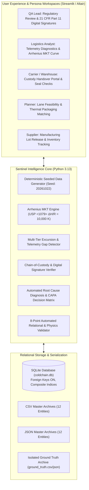
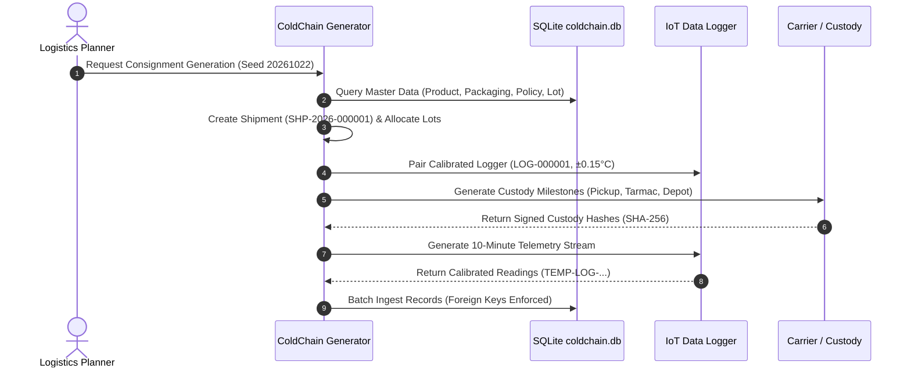
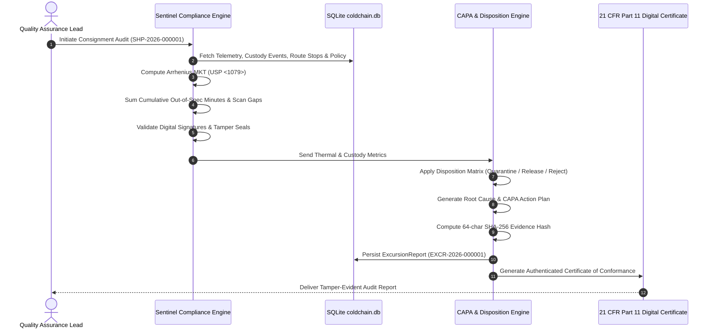

# 🏛️ ColdChain Sentinel — System Architecture Blueprint

## 1. System Overview & Architectural Principles

ColdChain Sentinel is built upon the **GAMP-5 (Good Automated Manufacturing Practice)** framework and adheres to **FDA 21 CFR Part 11** for pharmaceutical software verification. The architecture enforces three core tenets:
1. **Immutable Auditability:** Telemetry and chain-of-custody handovers are append-only. State changes produce explicit audit events rather than mutating history.
2. **Physics-Based Kinetic Evaluation:** Temperature compliance is evaluated via continuous Arrhenius kinetic degradation models rather than simplistic threshold slicing.
3. **Traceable Disposition Governance:** Quality decisions (Release, Quarantine, Destroy) are deterministically linked to documented policy limits, sensor calibration uncertainty, and cryptographic digital signatures.

---

## 2. High-Level System Architecture

---

## 3. Core Architectural Components

### 3.1 Master Data Layer (`coldchain/models.py`)
Establishes the foundational regulatory catalog prior to any transactional activity:
- **`Product`**: Therapeutic biologics with defined stability bands (`ULTRA_COLD` $-80^\circ\text{C}$ to $-60^\circ\text{C}$, `REFRIGERATED` $+2^\circ\text{C}$ to $+8^\circ\text{C}$).
- **`Packaging`**: Thermal shippers with certified hold durations and maximum ambient ratings.
- **`ThresholdPolicy`**: Temperature limits, cumulative excursion allowance (e.g. 120 mins), single spike allowance (e.g. 60 mins), and MKT ceilings.
- **`Lot`**: Batches with expiration dates and initial manufacturing QA release status.
- **`Logger`**: IoT monitoring devices paired with NIST-traceable calibration certificates ($\pm 0.15^\circ\text{C}$).

### 3.2 Telemetry & Time-Series Engine (`coldchain/generator.py`)
Simulates real-world physical transit dynamics:
- **10-Minute Sampling Cadence:** Generates timestamped readings formatted as `TEMP-<logger_id>-<YYYYMMDDHHMM>`.
- **Thermal Inertia & Diurnal Cycling:** Payload temperature reflects mean-reverting thermal resistance of vacuum-insulated panels, modified by external ambient fluctuations during airport tarmac dwells.
- **Sensor Calibration Uncertainty:** Introduces sensor noise within NIST calibration bounds ($\pm 0.15^\circ\text{C}$), preserving raw vs calibrated temperature deltas.
- **Controlled Injected Anomaly Engine:** Synthesizes five negative scenarios (unassigned logger, policy mismatch, telemetry blackout, custody gap, cross-shipment contamination) and isolates them in `ground_truth.csv`/`.json`.

### 3.3 Physics & Compliance Engine (`coldchain/compliance.py`)
Evaluates compliance against biopharmaceutical standards:
- **Arrhenius Mean Kinetic Temperature (MKT):**
  $$T_{\text{MKT}} = \frac{10000}{-\ln\left(\frac{1}{n}\sum_{i=1}^{n} e^{-\frac{10000}{T_i + 273.15}}\right)} - 273.15$$
- **Telemetry Gap Detector:** Flags consecutive reading intervals exceeding policy tolerance ($> 30\text{ min}$).
- **Tamper-Evident Hashing:** Calculates a SHA-256 fingerprint sealing the shipment telemetry and custody chain.

### 3.4 Automated CAPA & Disposition Matrix
Maps thermal and chain-of-custody violations to regulatory actions:
- **Critical Freeze Breach ($T \le 0^\circ\text{C}$ for biologics):** Triggers `REJECT_AND_DESTROY` due to irreversible protein denaturation.
- **Cumulative Excursion Exceeded ($> 120\text{ min}$):** Triggers `QUARANTINE_FOR_ASSAY` for HPLC potency testing.
- **MKT Limit Breach ($T_{\text{MKT}} > 8.0^\circ\text{C}$):** Triggers `RELEASE_WITH_CAUTION` with 30-day shelf-life reduction.
- **Custody Gap / Broken Seal:** Issues formal carrier non-conformance notice.

---

## 4. Architectural Sequence Diagrams

### Sequence 1: End-to-End Shipment Generation & Telemetry Ingestion

### Sequence 2: Compliance Evaluation, Excursion Detection & CAPA Resolution

---

## 5. Security, Auditability & 21 CFR Part 11 Compliance

| Regulatory Requirement | Implementation in ColdChain Sentinel |
| :--- | :--- |
| **Audit Trails (§11.10(e))** | Append-only event history in `custody_events` and `excursion_reports`. No overwriting of records. |
| **Electronic Signatures (§11.50)** | Every custody handover and QA disposition captures actor name, role, timestamp, and SHA-256 digital signature hash. |
| **Authority Checks (§11.10(g))** | Persona switcher gates QA disposition sign-off to authorized roles (`Quality Assurance Lead`, `Operations Manager`). |
| **Evidence Tamper-Evidence** | Composite SHA-256 hash sealing reading distributions and custody events ensures undetectable post-hoc data tampering. |
| **Validation of Systems (§11.10(a))** | Automated 8-point validator (`cli.py validate`) and dual-generation seed verification (`cli.py verify`). |
