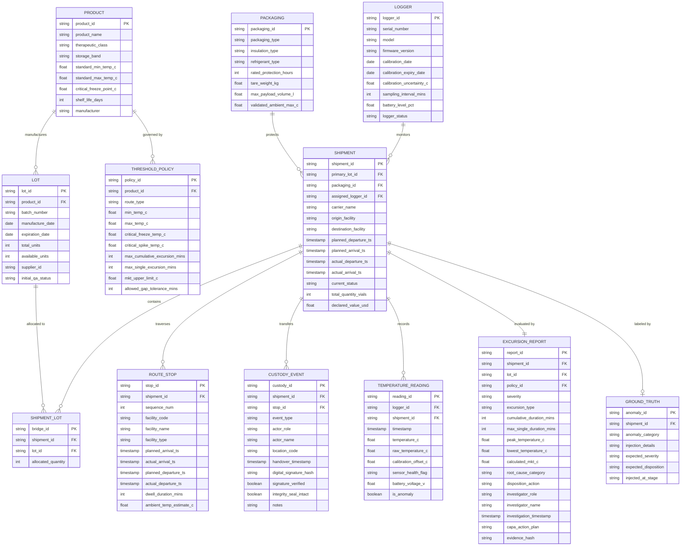

# ColdChain Sentinel — Data Dictionary & Relational Schema Specification

## 1. System Overview & Problem Statement
ColdChain Sentinel is an end-to-end data and compliance system designed to prove that temperature-sensitive biologics and pharmaceuticals remained within validated product and route specifications from manufacturer release through final clinical delivery, and to govern excursion deviations in compliance with **FDA 21 CFR Part 11**, **USP <1079>**, and **EU GDP (Good Distribution Practice)**.

---

## 2. Entity Relationship Model (ERD)

---

## 3. Granular Data Dictionary (10 Core Entities + Ground Truth)

### 3.1 Entity: Product (`products`)
Master catalog of biological and pharmaceutical products.

| Field Name | Type | Req/Opt | Allowed Values / Enums | Units | Uniqueness | Validation Rule |
| :--- | :--- | :--- | :--- | :--- | :--- | :--- |
| `product_id` | String | Required | Format `PRD-[0-9]{3}` | - | Unique (PK) | Regex `^PRD-\d{3}$` |
| `product_name` | String | Required | Free text (e.g., Comirna-mRNA) | - | Non-unique | Length 3-100 characters |
| `therapeutic_class` | String | Required | `MRNA_VACCINE`, `MONOCLONAL_ANTIBODY`, `INSULIN_ANALOG`, `CELL_THERAPY`, `BLOOD_PLASMA`, `SPECIALTY_PHARMA` | - | Non-unique | Must belong to therapeutic class enum |
| `storage_band` | String | Required | `ULTRA_COLD`, `FROZEN`, `REFRIGERATED`, `CRT` | - | Non-unique | Must match thermal band enum |
| `standard_min_temp_c` | Float | Required | -95.0 to 25.0 | °C | Non-unique | `standard_min_temp_c < standard_max_temp_c` |
| `standard_max_temp_c` | Float | Required | -60.0 to 30.0 | °C | Non-unique | `standard_max_temp_c > standard_min_temp_c` |
| `critical_freeze_point_c` | Float | Required | -120.0 to 5.0 | °C | Non-unique | `critical_freeze_point_c <= standard_min_temp_c` |
| `shelf_life_days` | Integer | Required | 30 to 1825 | Days | Non-unique | Positive integer |
| `manufacturer` | String | Required | Free text | - | Non-unique | Length 3-100 characters |

---

### 3.2 Entity: Lot (`lots`)
Specific manufacturing batch released under a Product master.

| Field Name | Type | Req/Opt | Allowed Values / Enums | Units | Uniqueness | Validation Rule |
| :--- | :--- | :--- | :--- | :--- | :--- | :--- |
| `lot_id` | String | Required | Format `LOT-2026-[0-9]{6}` | - | Unique (PK) | Regex `^LOT-2026-\d{6}$` |
| `product_id` | String | Required | Must reference `products.product_id` | - | Non-unique (FK) | Valid foreign key |
| `batch_number` | String | Required | Alphanumeric (e.g. `BATCH-2026-X77`) | - | Unique | Batch identifier |
| `manufacture_date` | String | Required | ISO 8601 Date (`YYYY-MM-DD`) | - | Non-unique | `manufacture_date < expiration_date` |
| `expiration_date` | String | Required | ISO 8601 Date (`YYYY-MM-DD`) | - | Non-unique | `expiration_date > manufacture_date` |
| `total_units` | Integer | Required | 100 to 1,000,000 | Vials/Units | Non-unique | Positive integer |
| `available_units` | Integer | Required | 0 to `total_units` | Vials/Units | Non-unique | `0 <= available_units <= total_units` |
| `supplier_id` | String | Required | Format `SUP-[0-9]{3}` | - | Non-unique | Valid vendor ID |
| `initial_qa_status` | String | Required | `APPROVED`, `PENDING`, `REJECTED` | - | Non-unique | Release status enum |

---

### 3.3 Entity: Packaging (`packagings`)
Thermal insulated container profile and qualification specs.

| Field Name | Type | Req/Opt | Allowed Values / Enums | Units | Uniqueness | Validation Rule |
| :--- | :--- | :--- | :--- | :--- | :--- | :--- |
| `packaging_id` | String | Required | Format `PKG-[0-9]{3}` | - | Unique (PK) | Regex `^PKG-\d{3}$` |
| `packaging_type` | String | Required | `VIP_PCM_CHILLED`, `DRY_ICE_DEEP_FROZEN`, `ACTIVE_RKN_E2`, `EPS_GEL_PACK_STANDARD` | - | Non-unique | Packaging category enum |
| `insulation_type` | String | Required | Free text describing barrier technology | - | Non-unique | Non-empty |
| `refrigerant_type` | String | Required | PCM (+5°C), Dry Ice (-78.5°C), Active Compressor, Ice Packs | - | Non-unique | Non-empty |
| `rated_protection_hours` | Integer | Required | 24 to 240 | Hours | Non-unique | Positive integer |
| `tare_weight_kg` | Float | Required | 1.0 to 1000.0 | kg | Non-unique | Positive float |
| `max_payload_volume_l` | Float | Required | 1.0 to 2500.0 | Liters | Non-unique | Positive float |
| `validated_ambient_max_c` | Float | Required | 20.0 to 55.0 | °C | Non-unique | Temperature limit |

---

### 3.4 Entity: Logger (`loggers`)
Calibrated IoT temperature monitoring device.

| Field Name | Type | Req/Opt | Allowed Values / Enums | Units | Uniqueness | Validation Rule |
| :--- | :--- | :--- | :--- | :--- | :--- | :--- |
| `logger_id` | String | Required | Format `LOG-[0-9]{6}` | - | Unique (PK) | Regex `^LOG-\d{6}$` |
| `serial_number` | String | Required | Unique hardware S/N | - | Unique | Alphanumeric |
| `model` | String | Required | Hardware model name | - | Non-unique | Non-empty |
| `firmware_version` | String | Required | Semantic version string | - | Non-unique | Regex `^v\d+\.\d+\.\d+$` |
| `calibration_date` | String | Required | ISO 8601 Date (`YYYY-MM-DD`) | - | Non-unique | Past or current date |
| `calibration_expiry_date` | String | Required | ISO 8601 Date (`YYYY-MM-DD`) | - | Non-unique | `calibration_expiry_date > calibration_date` |
| `calibration_uncertainty_c` | Float | Required | 0.05 to 0.30 | ±°C | Non-unique | NIST traceable uncertainty |
| `sampling_interval_mins` | Integer | Required | 1 to 60 (Standard: 10) | Minutes | Non-unique | Standard: 10 minutes |
| `battery_level_pct` | Float | Required | 0.0 to 100.0 | % | Non-unique | `0.0 <= battery_level_pct <= 100.0` |
| `logger_status` | String | Required | `CALIBRATED`, `ACTIVE`, `IN_USE`, `EXPIRED`, `UNASSIGNED`, `FAULTY` | - | Non-unique | Enum check |

---

### 3.5 Entity: Shipment (`shipments`)
Physical transit consignment from origin facility to clinical destination.

| Field Name | Type | Req/Opt | Allowed Values / Enums | Units | Uniqueness | Validation Rule |
| :--- | :--- | :--- | :--- | :--- | :--- | :--- |
| `shipment_id` | String | Required | Format `SHP-2026-[0-9]{6}` | - | Unique (PK) | Regex `^SHP-2026-\d{6}$` |
| `primary_lot_id` | String | Required | Reference `lots.lot_id` | - | Non-unique (FK) | Valid foreign key |
| `packaging_id` | String | Required | Reference `packagings.packaging_id` | - | Non-unique (FK) | Valid foreign key |
| `assigned_logger_id` | String | Optional | Reference `loggers.logger_id` or `LOG-<shipment_id>-01` (Null if unassigned anomaly) | - | Non-unique | Nullable for unassigned edge case |
| `carrier_name` | String | Required | Logistics provider | - | Non-unique | Non-empty |
| `origin_facility` | String | Required | Origin hub string | - | Non-unique | Non-empty |
| `destination_facility` | String | Required | Destination depot string | - | Non-unique | Non-empty |
| `planned_departure_ts` | String | Required | ISO 8601 Timestamp | - | Non-unique | `planned_departure_ts < planned_arrival_ts` |
| `planned_arrival_ts` | String | Required | ISO 8601 Timestamp | - | Non-unique | `planned_arrival_ts > planned_departure_ts` |
| `actual_departure_ts` | String | Optional | ISO 8601 Timestamp | - | Non-unique | Valid timestamp |
| `actual_arrival_ts` | String | Optional | ISO 8601 Timestamp | - | Non-unique | Valid timestamp |
| `current_status` | String | Required | `PLANNED`, `IN_TRANSIT`, `DELIVERED`, `QUARANTINED`, `REJECTED`, `RELEASED` | - | Non-unique | Valid lifecycle status |
| `total_quantity_vials` | Integer | Required | 1 to 50,000 | Vials | Non-unique | Positive integer |
| `declared_value_usd` | Float | Required | 1000.0 to 5,000,000.0 | USD ($) | Non-unique | Positive float |

---

### 3.6 Entity: RouteStop (`route_stops`)
Scheduled and actual intermediate stops (cross-docking, airport transfer, customs).

| Field Name | Type | Req/Opt | Allowed Values / Enums | Units | Uniqueness | Validation Rule |
| :--- | :--- | :--- | :--- | :--- | :--- | :--- |
| `stop_id` | String | Required | Format `STOP-SHP-2026-[0-9]{6}-[0-9]{2}` | - | Unique (PK) | Structured ID |
| `shipment_id` | String | Required | Reference `shipments.shipment_id` | - | Non-unique (FK) | Valid foreign key |
| `sequence_num` | Integer | Required | 1, 2, 3... | - | Non-unique | Monotonically increasing per shipment |
| `facility_code` | String | Required | Hub IATA / Depot Code (e.g. FRA-HUB) | - | Non-unique | 3-10 characters |
| `facility_name` | String | Required | Free text facility name | - | Non-unique | Non-empty |
| `facility_type` | String | Required | `ORIGIN_FACILITY`, `AIRPORT_HUB`, `CROSS_DOCK`, `DESTINATION_DEPOT` | - | Non-unique | Facility enum |
| `planned_arrival_ts` | String | Required | ISO 8601 Timestamp | - | Non-unique | Chronological ordering |
| `actual_arrival_ts` | String | Required | ISO 8601 Timestamp | - | Non-unique | Chronological ordering |
| `planned_departure_ts` | String | Required | ISO 8601 Timestamp | - | Non-unique | `planned_departure_ts >= planned_arrival_ts` |
| `actual_departure_ts` | String | Required | ISO 8601 Timestamp | - | Non-unique | `actual_departure_ts >= actual_arrival_ts` |
| `dwell_duration_mins` | Integer | Required | Dwell time | Minutes | Non-unique | Non-negative integer |
| `ambient_temp_estimate_c`| Float | Required | Exterior ambient air temp | °C | Non-unique | -40.0 to 55.0 °C |

---

### 3.7 Entity: CustodyEvent (`custody_events`)
Chain-of-custody transfer records with cryptographic signatures and seal integrity.

| Field Name | Type | Req/Opt | Allowed Values / Enums | Units | Uniqueness | Validation Rule |
| :--- | :--- | :--- | :--- | :--- | :--- | :--- |
| `custody_id` | String | Required | Format `CUST-SHP-2026-[0-9]{6}-[0-9]{2}` | - | Unique (PK) | Structured ID |
| `shipment_id` | String | Required | Reference `shipments.shipment_id` | - | Non-unique (FK) | Valid foreign key |
| `stop_id` | String | Optional | Reference `route_stops.stop_id` | - | Non-unique (FK) | Nullable FK |
| `event_type` | String | Required | `PICKUP_ORIGIN`, `AIRPORT_TRANSFER_ORIGIN`, `FLIGHT_DEPARTURE`, `FLIGHT_ARRIVAL`, `CUSTOMS_CLEARANCE`, `CROSS_DOCK_DEPOT`, `FINAL_DELIVERY` | - | Non-unique | Milestone enum |
| `actor_role` | String | Required | `SUPPLIER`, `PLANNER`, `CARRIER`, `WAREHOUSE_OPERATOR`, `LOGISTICS_ANALYST`, `OPERATIONS_MANAGER`, `QUALITY_ASSURANCE` | - | Non-unique | Actor role enum |
| `actor_name` | String | Required | Signatory full name | - | Non-unique | Non-empty |
| `location_code` | String | Required | Location identifier | - | Non-unique | Non-empty |
| `handover_timestamp` | String | Required | ISO 8601 Timestamp | - | Non-unique | Valid timestamp |
| `digital_signature_hash`| String | Required | SHA-256 hash or error string | - | Non-unique | 64-char hex or error flag |
| `signature_verified` | Boolean | Required | `True`, `False` | - | Non-unique | Injected False for custody gap |
| `integrity_seal_intact`| Boolean | Required | `True`, `False` | - | Non-unique | Physical seal status |
| `notes` | String | Optional | Handover observations | - | Non-unique | Free text |

---

### 3.8 Entity: TemperatureReading (`temperature_readings`)
Time-series periodic telemetry captured by logger.

| Field Name | Type | Req/Opt | Allowed Values / Enums | Units | Uniqueness | Validation Rule |
| :--- | :--- | :--- | :--- | :--- | :--- | :--- |
| `reading_id` | String | Required | Format `TEMP-<logger_id>-<YYYYMMDDHHMM>` | - | Unique (PK) | Deterministic composite key |
| `logger_id` | String | Required | Reference `loggers.logger_id` | - | Non-unique (FK) | Logger identifier |
| `shipment_id` | String | Required | Reference `shipments.shipment_id` | - | Non-unique (FK) | Shipment identifier |
| `timestamp` | String | Required | ISO 8601 Timestamp | - | Non-unique | Reading interval (10 min) |
| `temperature_c` | Float | Required | Calibrated sensed temperature | °C | Non-unique | `temperature_c = raw + offset` |
| `raw_temperature_c` | Float | Required | Uncalibrated sensor ADC temperature | °C | Non-unique | Physical float |
| `calibration_offset_c` | Float | Required | ±0.01 to ±0.20 | °C | Non-unique | NIST calibration delta |
| `sensor_health_flag` | String | Required | `OK`, `BATTERY_LOW`, `TRANSMISSION_DELAY`, `GAP_INTERPOLATED` | - | Non-unique | Sensor health enum |
| `battery_voltage_v` | Float | Required | 2.8 to 3.6 | Volts (V) | Non-unique | Operating voltage |
| `is_anomaly` | Boolean | Required | `True`, `False` | - | Non-unique | Threshold boundary flag |

---

### 3.9 Entity: ThresholdPolicy (`policies`)
Thermal governance boundaries and exposure tolerances.

| Field Name | Type | Req/Opt | Allowed Values / Enums | Units | Uniqueness | Validation Rule |
| :--- | :--- | :--- | :--- | :--- | :--- | :--- |
| `policy_id` | String | Required | Format `POL-[0-9]{3}` | - | Unique (PK) | Regex `^POL-\d{3}$` |
| `product_id` | String | Required | Reference `products.product_id` | - | Non-unique (FK) | Valid foreign key |
| `route_type` | String | Required | `GLOBAL_AIR_EXPEDITE`, `CROSS_BORDER_REEFER`, `PHARMA_COLD_EXPRESS` | - | Non-unique | Route classification |
| `min_temp_c` | Float | Required | Lower specification limit | °C | Non-unique | `min_temp_c < max_temp_c` |
| `max_temp_c` | Float | Required | Upper specification limit | °C | Non-unique | `max_temp_c > min_temp_c` |
| `critical_freeze_temp_c`| Float | Required | Irreversible protein denaturation temp | °C | Non-unique | `critical_freeze_temp_c <= min_temp_c` |
| `critical_spike_temp_c` | Float | Required | Acute degradation ceiling | °C | Non-unique | `critical_spike_temp_c >= max_temp_c` |
| `max_cumulative_excursion_mins` | Integer | Required | 30 to 480 | Minutes | Non-unique | Regulatory allowance limit |
| `max_single_excursion_mins` | Integer | Required | 15 to 120 | Minutes | Non-unique | Single spike allowance limit |
| `mkt_upper_limit_c` | Float | Required | Mean Kinetic Temperature ceiling | °C | Non-unique | Arrhenius kinetic ceiling |
| `allowed_gap_tolerance_mins` | Integer | Required | 15 to 60 (Standard: 30) | Minutes | Non-unique | Max telemetry blackout |

---

### 3.10 Entity: ExcursionReport (`excursion_reports`)
Formal quality deviation report and CAPA resolution record.

| Field Name | Type | Req/Opt | Allowed Values / Enums | Units | Uniqueness | Validation Rule |
| :--- | :--- | :--- | :--- | :--- | :--- | :--- |
| `report_id` | String | Required | Format `EXCR-2026-[0-9]{6}` | - | Unique (PK) | Regex `^EXCR-2026-\d{6}$` |
| `shipment_id` | String | Required | Reference `shipments.shipment_id` | - | Unique (1:1) | Valid foreign key |
| `lot_id` | String | Required | Reference `lots.lot_id` | - | Non-unique (FK) | Valid foreign key |
| `policy_id` | String | Required | Reference `policies.policy_id` | - | Non-unique (FK) | Valid foreign key |
| `severity` | String | Required | `NONE`, `MINOR`, `MODERATE`, `CRITICAL` | - | Non-unique | Severity enum |
| `excursion_type` | String | Required | `NONE`, `HIGH_TEMPERATURE`, `LOW_TEMPERATURE`, `MKT_BREACH`, `DATA_TRANSMISSION_GAP`, `CUSTODY_INTEGRITY_BREACH`, `SENSOR_UNASSIGNED`, `THRESHOLD_MISMATCH` | - | Non-unique | Excursion type enum |
| `cumulative_duration_mins` | Integer | Required | Derived sum of out-of-spec intervals | Minutes | Non-unique | Reconciled against readings |
| `max_single_duration_mins` | Integer | Required | Longest single spike | Minutes | Non-unique | Reconciled against readings |
| `peak_temperature_c` | Float | Required | Sensed maximum | °C | Non-unique | Reconciled against `max(readings)` |
| `lowest_temperature_c` | Float | Required | Sensed minimum | °C | Non-unique | Reconciled against `min(readings)` |
| `calculated_mkt_c` | Float | Required | Arrhenius MKT | °C | Non-unique | Reconciled against Arrhenius formula |
| `root_cause_category` | String | Required | Root cause classification | - | Non-unique | Standard deviation codes |
| `disposition_action` | String | Required | `PENDING_REVIEW`, `RELEASE_STANDARD`, `RELEASE_WITH_CAUTION`, `QUARANTINE_FOR_ASSAY`, `REJECT_AND_DESTROY` | - | Non-unique | Quality disposition enum |
| `investigator_role` | String | Required | Role of responsible QA officer | - | Non-unique | ActorRole enum |
| `investigator_name` | String | Required | Full name of investigator | - | Non-unique | Non-empty |
| `investigation_timestamp` | String | Required | ISO 8601 Timestamp | - | Non-unique | Valid timestamp |
| `capa_action_plan` | String | Required | Corrective and Preventive Action plan | - | Non-unique | Detailed text |
| `evidence_hash` | String | Required | SHA-256 tamper-evident fingerprint | - | Non-unique | 64-character hex |

---

### 3.11 Ground Truth Labels (`ground_truth`)
Separate ground-truth evaluation table (never leaked into analysis features).

| Field Name | Type | Req/Opt | Allowed Values / Enums | Units | Uniqueness | Validation Rule |
| :--- | :--- | :--- | :--- | :--- | :--- | :--- |
| `anomaly_id` | String | Required | Format `ANOM-2026-[0-9]{6}` | - | Unique (PK) | Regex `^ANOM-2026-\d{6}$` |
| `shipment_id` | String | Required | Reference `shipments.shipment_id` | - | Unique | 1:1 with shipment |
| `anomaly_category` | String | Required | `NONE`, `LOGGER_NOT_ASSIGNED`, `THRESHOLD_MISMATCH`, `MISSING_DATA_GAP`, `CUSTODY_GAP`, `CROSS_SHIPMENT_CONTAMINATION` | - | Non-unique | Ground truth enum |
| `injection_details` | String | Required | Description of injected defect | - | Non-unique | Non-empty |
| `expected_severity` | String | Required | Expected severity outcome | - | Non-unique | ExcursionSeverity enum |
| `expected_disposition` | String | Required | Expected disposition action | - | Non-unique | DispositionAction enum |
| `injected_at_stage` | String | Required | Pipeline stage | - | Non-unique | Non-empty |
