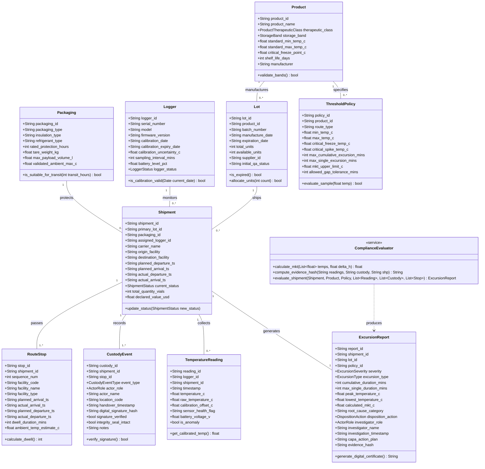

# 📊 ColdChain Sentinel — Database UML & Entity Relationship Specification

## 1. Executive Summary
This document provides the complete structural modeling for the **ColdChain Sentinel** platform, including:
1. **Mermaid Entity-Relationship Diagram (ERD)** defining all 10 core entities, bridge tables, and the isolated ground truth entity.
2. **UML Class Diagram** defining attributes, data types, visibility, and methods.
3. **Relational Schema Matrix** detailing primary keys, foreign keys, constraints, cardinalities (1:1, 1:N, N:M), and indexing strategies.

---

## 2. Entity-Relationship Diagram (ERD)

```mermaid
erDiagram
    PRODUCT ||--o{ LOT : "manufactures (1:N)"
    PRODUCT ||--o{ THRESHOLD_POLICY : "governed by (1:N)"
    LOT ||--o{ SHIPMENT_LOT : "allocated to (1:N)"
    SHIPMENT ||--o{ SHIPMENT_LOT : "contains (1:N)"
    PACKAGING ||--o{ SHIPMENT : "protects (1:N)"
    LOGGER ||--o{ SHIPMENT : "monitors (1:1/1:N)"
    SHIPMENT ||--o{ ROUTE_STOP : "traverses (1:N)"
    SHIPMENT ||--o{ CUSTODY_EVENT : "transfers (1:N)"
    SHIPMENT ||--o{ TEMPERATURE_READING : "records (1:N)"
    SHIPMENT ||--|| EXCURSION_REPORT : "evaluated by (1:1)"
    SHIPMENT ||--o| GROUND_TRUTH : "labeled by (1:1)"

    PRODUCT {
        string product_id PK "PRD-001"
        string product_name "Comirna-mRNA Ultra"
        string therapeutic_class "MRNA_VACCINE"
        string storage_band "ULTRA_COLD | REFRIGERATED | FROZEN | CRT"
        float standard_min_temp_c "-80.0"
        float standard_max_temp_c "-60.0"
        float critical_freeze_point_c "-95.0"
        int shelf_life_days "270"
        string manufacturer "BioNTech-Pfizer Alliance"
    }

    LOT {
        string lot_id PK "LOT-2026-000001"
        string product_id FK "PRD-001"
        string batch_number "BATCH-2026-X77"
        date manufacture_date "2026-04-12"
        date expiration_date "2027-01-07"
        int total_units "10000"
        int available_units "9000"
        string supplier_id "SUP-003"
        string initial_qa_status "APPROVED | PENDING | REJECTED"
    }

    PACKAGING {
        string packaging_id PK "PKG-001"
        string packaging_type "VIP_PCM_CHILLED | DRY_ICE_DEEP_FROZEN | ACTIVE_RKN_E2"
        string insulation_type "Vacuum Insulated Panels (VIP)"
        string refrigerant_type "Phase Change Material (+5C paraffin)"
        int rated_protection_hours "96"
        float tare_weight_kg "14.5"
        float max_payload_volume_l "25.0"
        float validated_ambient_max_c "35.0"
    }

    LOGGER {
        string logger_id PK "LOG-000001"
        string serial_number "SN-IOT-99281"
        string model "SenseTemp IoT Pro 5G"
        string firmware_version "v2.4.1"
        date calibration_date "2026-03-01"
        date calibration_expiry_date "2027-03-01"
        float calibration_uncertainty_c "0.15"
        int sampling_interval_mins "10"
        float battery_level_pct "98.5"
        string logger_status "ACTIVE | IN_USE | EXPIRED | UNASSIGNED"
    }

    SHIPMENT {
        string shipment_id PK "SHP-2026-000001"
        string primary_lot_id FK "LOT-2026-000001"
        string packaging_id FK "PKG-001"
        string assigned_logger_id FK "LOG-SHP-2026-000001-01 (Nullable)"
        string carrier_name "FedEx Custom Critical Cold Chain"
        string origin_facility "Basel Central Bio Hub (CH-BSL)"
        string destination_facility "Boston Life Science Depot (US-BOS)"
        timestamp planned_departure_ts "ISO 8601"
        timestamp planned_arrival_ts "ISO 8601"
        timestamp actual_departure_ts "ISO 8601"
        timestamp actual_arrival_ts "ISO 8601"
        string current_status "PLANNED | IN_TRANSIT | DELIVERED | QUARANTINED | REJECTED | RELEASED"
        int total_quantity_vials "2500"
        float declared_value_usd "125000.00"
    }

    SHIPMENT_LOT {
        string bridge_id PK "SHPLOT-2026-000001"
        string shipment_id FK "SHP-2026-000001"
        string lot_id FK "LOT-2026-000001"
        int allocated_quantity "2500"
    }

    ROUTE_STOP {
        string stop_id PK "STOP-SHP-2026-000001-01"
        string shipment_id FK "SHP-2026-000001"
        int sequence_num "1, 2, 3"
        string facility_code "FRA-HUB"
        string facility_name "Frankfurt Cool Chain Terminal"
        string facility_type "ORIGIN_FACILITY | AIRPORT_HUB | CROSS_DOCK | DESTINATION_DEPOT"
        timestamp planned_arrival_ts "ISO 8601"
        timestamp actual_arrival_ts "ISO 8601"
        timestamp planned_departure_ts "ISO 8601"
        timestamp actual_departure_ts "ISO 8601"
        int dwell_duration_mins "240"
        float ambient_temp_estimate_c "28.5"
    }

    CUSTODY_EVENT {
        string custody_id PK "CUST-SHP-2026-000001-01"
        string shipment_id FK "SHP-2026-000001"
        string stop_id FK "STOP-SHP-2026-000001-01"
        string event_type "PICKUP_ORIGIN | AIRPORT_TRANSFER | FLIGHT_DEPARTURE | FINAL_DELIVERY"
        string actor_role "SUPPLIER | CARRIER | WAREHOUSE_OPERATOR | LOGISTICS_ANALYST | OPERATIONS_MANAGER"
        string actor_name "Hans Gruber (Lufthansa Cargo)"
        string location_code "FRA-CARGO-T1"
        timestamp handover_timestamp "ISO 8601"
        string digital_signature_hash "SHA-256 Hex Digest"
        boolean signature_verified "true | false"
        boolean integrity_seal_intact "true | false"
        string notes "Cold room transfer verified"
    }

    TEMPERATURE_READING {
        string reading_id PK "TEMP-LOG-SHP-2026-000001-01-YYYYMMDDHHMM"
        string logger_id FK "LOG-SHP-2026-000001-01"
        string shipment_id FK "SHP-2026-000001"
        timestamp timestamp "ISO 8601 (Every 10 min)"
        float temperature_c "4.8"
        float raw_temperature_c "4.75"
        float calibration_offset_c "+0.05"
        string sensor_health_flag "OK | BATTERY_LOW | TRANSMISSION_DELAY | GAP_INTERPOLATED"
        float battery_voltage_v "3.28"
        boolean is_anomaly "false"
    }

    THRESHOLD_POLICY {
        string policy_id PK "POL-001"
        string product_id FK "PRD-001"
        string route_type "GLOBAL_AIR_EXPEDITE | CROSS_BORDER_REEFER | PHARMA_COLD_EXPRESS"
        float min_temp_c "2.0"
        float max_temp_c "8.0"
        float critical_freeze_temp_c "0.0"
        float critical_spike_temp_c "15.0"
        int max_cumulative_excursion_mins "120"
        int max_single_excursion_mins "60"
        float mkt_upper_limit_c "8.0"
        int allowed_gap_tolerance_mins "30"
    }

    EXCURSION_REPORT {
        string report_id PK "EXCR-2026-000001"
        string shipment_id FK "SHP-2026-000001"
        string lot_id FK "LOT-2026-000001"
        string policy_id FK "POL-001"
        string severity "NONE | MINOR | MODERATE | CRITICAL"
        string excursion_type "NONE | HIGH_TEMP | LOW_TEMP | MKT_BREACH | DATA_GAP | CUSTODY_BREACH"
        int cumulative_duration_mins "40"
        int max_single_duration_mins "30"
        float peak_temperature_c "9.2"
        float lowest_temperature_c "3.1"
        float calculated_mkt_c "5.8"
        string root_cause_category "TARMAC_PROLONGED_DWELL"
        string disposition_action "RELEASE_STANDARD | RELEASE_WITH_CAUTION | QUARANTINE_FOR_ASSAY | REJECT_AND_DESTROY"
        string investigator_role "OPERATIONS_MANAGER | QUALITY_ASSURANCE"
        string investigator_name "ColdChain Sentinel Automated QA"
        timestamp investigation_timestamp "ISO 8601"
        string capa_action_plan "CAPA Root Cause & Corrective Action Text"
        string evidence_hash "SHA-256 Tamper-Evident Fingerprint"
    }

    GROUND_TRUTH {
        string anomaly_id PK "ANOM-2026-000001"
        string shipment_id FK "SHP-2026-000001"
        string anomaly_category "NONE | LOGGER_NOT_ASSIGNED | THRESHOLD_MISMATCH | MISSING_DATA_GAP | CUSTODY_GAP | CROSS_SHIPMENT_CONTAMINATION"
        string injection_details "Injected defect description"
        string expected_severity "NONE | MINOR | MODERATE | CRITICAL"
        string expected_disposition "RELEASE_STANDARD | QUARANTINE_FOR_ASSAY | REJECT_AND_DESTROY"
        string injected_at_stage "GENERATION_PIPELINE"
    }
```

---

## 3. UML Class Diagram (Domain Model & Operations)

---

## 4. Relational Schema & Constraints Matrix

| Table Name | Primary Key | Foreign Keys & Target | Cardinality | Unique Constraints & Indices |
| :--- | :--- | :--- | :--- | :--- |
| **`products`** | `product_id` | *None (Master Table)* | 1:N with `lots`, `policies` | `PK: product_id` |
| **`packagings`** | `packaging_id` | *None (Master Table)* | 1:N with `shipments` | `PK: packaging_id` |
| **`policies`** | `policy_id` | `product_id` $\rightarrow$ `products.product_id` | N:1 with `products` | `PK: policy_id`, `FK: product_id` |
| **`lots`** | `lot_id` | `product_id` $\rightarrow$ `products.product_id` | N:1 with `products` | `PK: lot_id`, `UNIQUE: batch_number` |
| **`loggers`** | `logger_id` | *None (Master Table)* | 1:1 or 1:N with `shipments` | `PK: logger_id`, `UNIQUE: serial_number` |
| **`shipments`** | `shipment_id` | `primary_lot_id` $\rightarrow$ `lots.lot_id` `packaging_id` $\rightarrow$ `packagings.packaging_id` | N:1 with `lots`, `packagings` | `PK: shipment_id`, `IDX: primary_lot_id` |
| **`shipment_lots`** | `bridge_id` | `shipment_id` $\rightarrow$ `shipments.shipment_id` `lot_id` $\rightarrow$ `lots.lot_id` | Bridge (N:M) | `PK: bridge_id`, `FK: shipment_id, lot_id` |
| **`route_stops`** | `stop_id` | `shipment_id` $\rightarrow$ `shipments.shipment_id` | N:1 with `shipments` | `PK: stop_id`, `IDX: shipment_id, seq` |
| **`custody_events`** | `custody_id` | `shipment_id` $\rightarrow$ `shipments.shipment_id` `stop_id` $\rightarrow$ `route_stops.stop_id` | N:1 with `shipments` | `PK: custody_id`, `IDX: shipment_id` |
| **`temperature_readings`**| `reading_id` | `shipment_id` $\rightarrow$ `shipments.shipment_id` `logger_id` $\rightarrow$ `loggers.logger_id` | N:1 with `shipments`, `loggers` | `PK: reading_id`, `IDX: shipment_id, ts` |
| **`excursion_reports`** | `report_id` | `shipment_id` $\rightarrow$ `shipments.shipment_id` `lot_id` $\rightarrow$ `lots.lot_id` `policy_id` $\rightarrow$ `policies.policy_id`| 1:1 with `shipments` | `PK: report_id`, `UNIQUE: shipment_id` |
| **`ground_truth`** | `anomaly_id` | `shipment_id` $\rightarrow$ `shipments.shipment_id` | 1:1 with `shipments` | `PK: anomaly_id`, `UNIQUE: shipment_id` |
