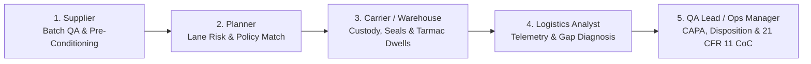
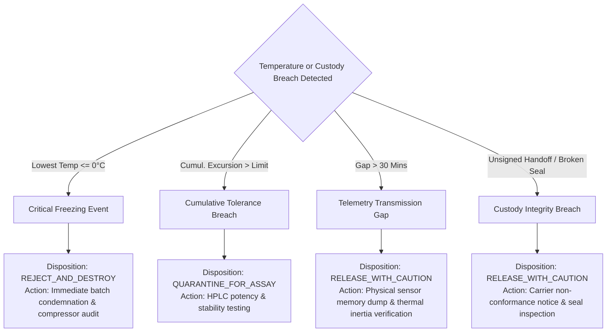

# 📚 ColdChain Sentinel — Biopharma Cold Chain Subject & Domain Guide

## 1. Industry Context & The Cold Chain Crisis
Over **\$35 billion worth of biopharmaceutical products are lost annually** due to temperature failures during global logistics. 

Unlike traditional small-molecule drugs (such as aspirin or paracetamol) that possess rigid crystalline chemical structures, modern therapeutics are **complex biological macromolecules**:
- **mRNA Vaccines (e.g. Comirnaty, Spikevax):** Enclosed in delicate lipid nanoparticles that rapidly rupture and hydrolyze if exposed to temperatures above $-60^\circ\text{C}$.
- **Monoclonal Antibodies (mAbs) & Insulin:** Large, folded protein structures. Even brief exposure to freeze conditions ($< 0^\circ\text{C}$) causes irreversible crystallization, structural unfolding (denaturation), and protein aggregation—triggering acute patient immunogenicity or fatal toxic shock.
- **Cell & Gene Therapies (e.g. CAR-T Kymriah):** Living patient cells preserved in liquid nitrogen or ultra-cold temperatures; a thermal deviation causes cell lysis and complete batch necrosis.

---

## 2. Regulatory Compliance Frameworks

### 2.1 FDA 21 CFR Part 11 (Electronic Records & Electronic Signatures)
The U.S. FDA mandates that electronic records in drug manufacturing and distribution must be trustworthy, reliable, and equivalent to paper records:
- **Audit Trails (§11.10(e)):** Computer-generated, time-stamped audit trails must independently record the date and time of operator entries and actions.
- **Authority Checks (§11.10(g)):** System access must be restricted to authorized individuals (e.g., only QA Leads can release or reject lots).
- **Electronic Signatures (§11.50):** Signed electronic records must clearly state the printed name of the signer, date/time, and the meaning of the signature (review, approval, responsibility).

### 2.2 USP <1079> (Good Storage and Shipping Practices)
The United States Pharmacopeia outlines formal criteria for temperature monitoring, packaging qualification, and excursion evaluations:
- **Mean Kinetic Temperature (MKT):** Legally recognizes MKT as an evaluation tool for brief deviations.
- **Calibration Traceability:** Data loggers must possess NIST-traceable 3-point calibration certificates with documented measurement uncertainty (typically $\le \pm 0.5^\circ\text{C}$, ideally $\pm 0.15^\circ\text{C}$).

### 2.3 EU GDP Guidelines (2013/C 343/01)
The European Commission requires full chain-of-custody verification:
- **Temperature Mapping:** Vehicles and storage areas must be thermally mapped.
- **Deviation Management (Section 5.5):** Any temperature excursion during transportation must be investigated, documented, and reported to the marketing authorization holder.

---

## 3. Mathematical Physics: Arrhenius Mean Kinetic Temperature (MKT)

### 3.1 Why Arithmetic Means Fail
If a consignment of $+2^\circ\text{C}$ to $+8^\circ\text{C}$ vaccines spends:
- 40 hours at $+4^\circ\text{C}$
- 8 hours at $+25^\circ\text{C}$ (on a sunny tarmac)

The simple arithmetic average is:
$$\bar{T} = \frac{(40 \times 4) + (8 \times 25)}{48} = 7.5^\circ\text{C}$$
The arithmetic average falsely indicates compliance ($7.5^\circ\text{C} < 8.0^\circ\text{C}$), even though chemical degradation at $+25^\circ\text{C}$ was **accelerating exponentially** and the batch is ruined.

### 3.2 The Arrhenius Formulation
Chemical degradation rate $k$ obeys the Arrhenius equation:
$$k = A \cdot e^{-\frac{\Delta H}{R \cdot T}}$$
Where:
- $A$ is the pre-exponential frequency factor
- $\Delta H$ is the standard activation energy ($83.144\text{ kJ/mol}$ for pharmaceutical active substances)
- $R$ is the universal gas constant ($8.314472 \times 10^{-3}\text{ kJ/(mol}\cdot\text{K)}$)
- $\Delta H / R = 10,000\text{ K}$ (USP <1079> standard constant)

Integrating over discrete 10-minute sensor telemetry intervals yields the official **USP <1079> Mean Kinetic Temperature equation**:

$$T_{\text{MKT}} = \frac{10000}{-\ln\left(\frac{1}{n}\sum_{i=1}^{n} e^{-\frac{10000}{T_i + 273.15}}\right)} - 273.15$$

In our scenario above, $T_{\text{MKT}} \approx \mathbf{13.2^\circ\text{C}}$, immediately flagging a severe excursion!

---

## 4. Thermal Packaging & Insulation Engineering

| Packaging Technology | Insulation Mechanism | Refrigerant Type | Typical Duration | Use Case |
| :--- | :--- | :--- | :--- | :--- |
| **VIP + PCM (Chilled)** | Vacuum Insulated Panels (VIP) | $+5^\circ\text{C}$ Phase Change Paraffin | 72 – 120 Hours | High-value $+2^\circ\text{C}$ to $+8^\circ\text{C}$ Biologics & Vaccines |
| **VIP + Dry Ice** | VIP with Polyurethane Outer Shell | Solid $\text{CO}_2$ Pellets ($-78.5^\circ\text{C}$) | 96 – 144 Hours | mRNA Vaccines & Cellular Material |
| **Active RKN Container** | Polyurethane + Aluminum Casing | Active Compressor & Heating Circuit | 120+ Hours (Rechargeable) | Bulk Palletized Air Cargo |
| **EPS Gel Pack Box** | Expanded Polystyrene (EPS) | Frozen Water-Based Gel Packs | 24 – 48 Hours | Domestic Overnight Courier |

---

## 5. Primary Actors & Operational Responsibilities

1. **Supplier:** Biopharmaceutical manufacturer. Authorizes batch release, assigns manufacturing lot numbers (`LOT-2026-000001`), packs containers in pre-conditioned cold rooms, and initiates sensor loggers.
2. **Planner:** Logistics architect. Evaluates route flight paths, ambient heat hazards, transit durations, and ensures the consignment is governed by the correct temperature policy (`POL-001`).
3. **Carrier / Warehouse Operator:** Freight logistics personnel (FedEx, DHL LifeConEx, Lufthansa Cargo). Executes physical handoffs, records tamper-evident security seal numbers, monitors airport tarmac dwell times, and submits digital signatures.
4. **Logistics Analyst:** Real-time telemetry monitoring specialist. Analyzes continuous 10-minute sensor streams, verifies sensor health and battery levels, detects transmission blackouts, and evaluates MKT curves.
5. **Operations Manager & Quality Assurance Lead:** Final regulatory authority. Reviews deviation reports (`EXCR-2026-000001`), investigates root causes, authorizes formal CAPA remediation plans, assigns lot disposition (`RELEASE`, `QUARANTINE`, `REJECT`), and cryptographically seals the **Certificate of Conformance**.

---

## 6. Deviation Management & CAPA Framework

When a thermal or chain-of-custody excursion occurs, the automated engine applies standard **GAMP-5 Root Cause Analysis**:

